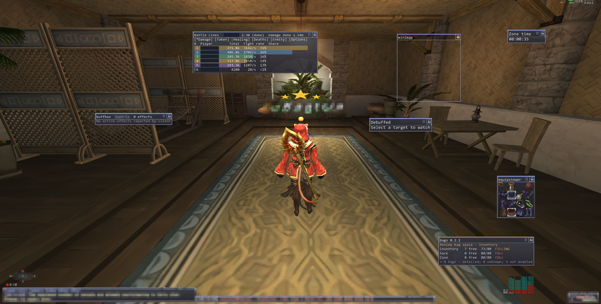
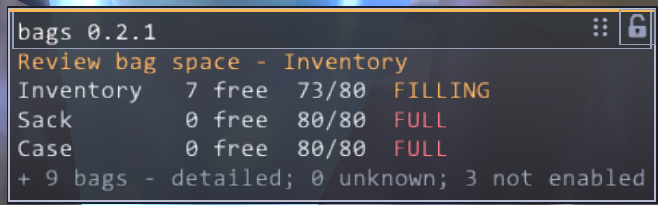
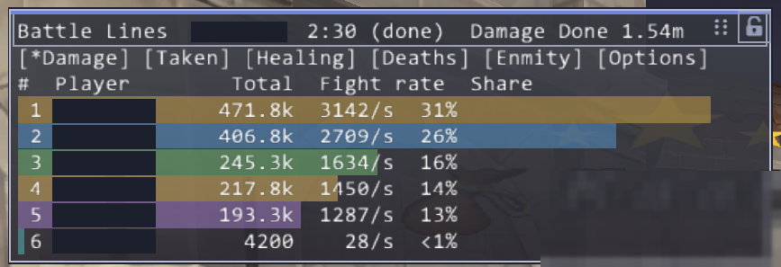
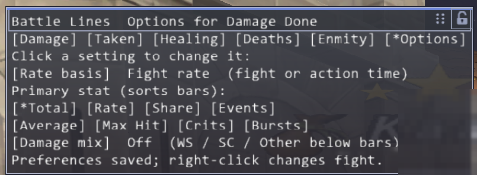

# ImpactLogic's FFXI add-ons

**WRITES TO YOUR DISK: the combat recorder (combatlog) saves your combat to files on your computer once recording is on. Recording ships OFF: combat files are written only after you load Checkup and Combatlog (`//lua l checkup`, `//lua l combatlog`) and type `//rec on combatlog`; `//rec off combatlog` stops them. The files go to `Windower4/addons/combatlog/data/<Character>/` (about 1.3 MB per day of play on average, 11 MB on the busiest day measured, never deleted for you), and nothing is uploaded. Read the notice at the top of `addons/combatlog/README.md` before you turn it on.**

**Free and non-commercial: no ads, no donations, no paid tier, nothing is sold.** The code is MIT licensed.

A set of small, read-only add-ons for Final Fantasy XI on [Windower 4](https://www.windower.net/): themed boxes for buffs, recasts, bags and a damage meter, a mission tracker, a character snapshot, and a setup checklist that ties them together. They are one person's hobby project, written with an AI coding assistant, and they come with no promises.

## What it looks like

Player and monster names are hidden in these pictures.

| Bags (`//bags box on`) | Battle Lines (`//bl box on`) |
|---|---|
|  |  |

Battle Lines also has an options page, reached by clicking **Options** in its box:

## Quick start

1. Download the ZIP under **Assets** on the latest [release](../../releases) and unzip it anywhere.
2. Double-click **`Install-FFXI-Addon-Suite.bat`**. It finds your Windower folder (or asks you to pick it) and copies the nine add-on folders in.
3. In the game, type the commands below into the chat line (press Enter, then type). Try `//lua l bags`, then `//bags layout compact` and `//bags box on`.
4. To try the guided setup, type `//lua l checkup`, then `//setup`.

Charsync writes a local character snapshot when loaded, including through setup. Combatlog saves combat
captures only when enabled. The table below describes the local files each addon creates.

## Read this first

- **Not every add-on has been confirmed in game.** The status below is the project's own registry: **confirmed** means it ran in the game at some point (not necessarily at this exact version), **not confirmed** means it has passed offline tests only and nobody has run it in game yet. Expect rough edges in anything marked not confirmed, and please report what you see.
- **Read-only, by design.** Each add-on's own README says it reads what the client already holds and sends nothing to the game. A search of the shipped code found no sockets, no process launches and no packet injection; web addresses in the code are source citations only. The one exception to "sends nothing" is `//bl report`, which types one chat line only when you ask for it.
- **Automation and the game's rules.** These add-ons only read and display. Anything that plays the game for you may break Square Enix's terms of service and can get an account banned; nothing here is meant to do that, and you are responsible for what you load.
- **Recording is opt-in.** Combat recording (`//rec on combatlog`) and Charsync's extra captures (Temprix menu text, Sortie state, learned spells, raw login packets) all ship OFF. What is on by default is Charsync's character snapshot (your bags, gear, jobs, points and so on, saved to local files on load and each zone) and the small `heap.csv` memory samples described below. Nothing is ever sent anywhere.
- **Memory:** combatlog holds about 20 MB of Lua memory per game client once loaded, flat over 12 days of samples; the cause was not investigated.

## Install

1. Download the ZIP under **Assets** on the latest [release](../../releases) (not "Source code") and unzip it anywhere, for example in your Downloads folder. The green **Code** button, then **Download ZIP**, also works.
2. Double-click **`Install-FFXI-Addon-Suite.bat`**. It looks for `Windower4`, asks you to pick the folder if it cannot find it, copies the nine folders into `Windower4\addons`, leaves every `data` folder alone, and tells you whether it worked.
   *By hand instead:* copy the nine folders inside `addons/` into the `addons` folder inside your Windower4 folder. You have it right when `Windower4\addons\bags\bags.lua` exists. The nine folders belong together: `//setup` needs at least `checkup` and `charsync`, and every add-on looks for `boxtheme` for its box background (without it the boxes are plain).
3. In the game, type commands into the chat line (press Enter, then type). Load an add-on with `//lua l <name>`, for example `//lua l bags`. After you replace the files of an add-on that is already loaded, reload it with `//lua r <name>`.
4. **To have them load every time you start the game,** open `Windower4\scripts\init.txt` in Notepad and add the line `lua load checkup` (the installer offers to do this for you). Without it, nothing is loaded after you restart the game. Checkup then loads the add-ons you ticked in step 5, about 30 seconds after you log in.
5. Optional: type `//setup` (alias `//ck`). It lists *modules* as check boxes, such as Story or Gear and character. `//setup tick story` then `//setup apply` loads the add-ons and boxes that module needs, and ticked modules are re-applied 30 seconds after login. Nothing is ever unloaded, and recording is never part of a module: it stays under `//rec`.
6. To show or hide an add-on's box: `//<command> box on` or `//<command> box off`.

`//setup` offers **Story** and **Gear and character**. Applying setup also loads Charsync, which saves character snapshots locally. See the Charsync row below.

To update, run the installer from the new ZIP (it keeps your data folders), then reload what you use with `//lua r <name>`. To remove an add-on, unload it with `//lua u <name>` and move its folder out of Windower. Keep a backup if you want to retain its settings or recordings.

## What is in the package

Each add-on's own README has the full command list and file list. Every one also writes `data/<addon>.log` and, where Windower's settings library is used, a `data/settings.xml`, inside its own folder.

**Memory sample file:** every add-on that draws a box, plus Charsync, also writes `data/heap.csv` in its own folder: one line about every 10 minutes (and one per zone change) with the time, your character name, and how much Lua memory that add-on is using (`time,char,raw_kb,live_kb,reason`). It exists to spot memory leaks, stays on your computer, is never sent anywhere, and is capped at about 200 KB (then it rotates to `heap.old.csv`). It contains no game data other than your character name. Delete it any time; it comes back on the next load.

| Add-on | What it does | Main commands | What it writes (in `Windower4/addons/<name>/data/`) | Status |
|---|---|---|---|---|
| **boxtheme** | Themed backgrounds, locks and accents for every box the other add-ons draw; also the `//rec` master switch for recorders | `//boxtheme`, `//boxtheme <addon> <theme>`, `//rec on\|off\|status` | `themes.txt`, `locks.txt`, `screens.txt`, `recording.cfg` | not confirmed |
| **buffbox** | Your buffs with time left, what your food gives, Corsair roll values, Bard song potency, Ionis coalition info, a low-time warning and a buff history | `//bb`, `//bb box on\|off`, `//bb layout full\|compact`, `//bb history`, `//bb warn` | `<Character>/food.txt`, `history.tsv`, `coalitions.tsv`, `stats.log` | confirmed |
| **timers** | Ability and spell recasts as a box with time bars; a Scholar stratagem charge row | `//tm box on\|off`, `//tm abilities on\|off`, `//tm spells on\|off`, `//tm rows <n>` | log only | not confirmed |
| **bags** | How full each bag is, as bubbles or numbers, with a low-space warning | `//bags box on\|off`, `//bags mode bubbles\|numbers\|both`, `//bags warn <n>` | log only | not confirmed |
| **battlelines** | A damage meter: damage, damage taken, healing, deaths, enmity, per fight | `//bl box`, `//bl view <tab>`, `//bl mode current\|overall\|last`, `//bl report <channel>` | `fights.tsv` | not confirmed |
| **storyguide** | A storyline tracker for missions and the quests that ride along with them: your place in each storyline, your own confirmations and ticks, and an evidence log. It lists every mission and quest by name in order; it ships no walkthrough text (see below) | `//sg box on\|off`, `//sg list`, `//sg track <name or number>`, `//sg at <mission>` | per-character progress and evidence files (`.tsv`) | not confirmed |
| **charsync** | A snapshot of one character: every item in every bag with augments, gil, jobs, equipment, key items, points, currencies, REMA weapons and quest/mission pages seen so far. It saves on load, 10 seconds after login and after every zone | `//cs`, `//cs status`, `//cs need`, `//cs last`, `//cs points`, `//cs rema` | `<Character>/snapshot.tsv`, `history/`, `points.tsv`, `rema.tsv`, `currencies.tsv`, progress files, and `contributor.txt` (a random id, never a character name) | confirmed (2026-10-04, earlier version) |
| **checkup** | One command that says which facts the other add-ons hold are missing or old, which recorders stopped writing, and which add-ons have errors in their logs; also `//setup` | `//setup`, `//ck todo`, `//ck full`, `//ck addons`, `//ck depart`, `//rec on\|off <name>` | `checkup.log` | not confirmed |
| **combatlog** | Records your combat to daily files (and a live box). **Off by default**, see the notice at the top | `//rec on\|off` to record; the add-on's own README lists the rest | `<Character>/combat-<date>.tsv`, `contributor.txt`, `shared/region_zones.txt` | confirmed earlier; the `//rec` switch hook (1.4.0) is tested offline only |

Also included: `templates/addon/`, a starting folder for writing your own add-on.

The add-on READMEs sometimes mention `tools/...` test scripts and the author's research notes. Those live in the author's private development repository and are not in this package; you do not need them to use the add-ons.

## Story Guide: a tracker, no walkthrough text

Story Guide in this package lists every mission and quest of 23 storylines by name and in order (`skeleton/`), tracks where you are and what you have ticked, and says "No step text for this mission yet" where nothing has been written. It does not include a walkthrough: no walkthrough or other website text ships, and no data pack is published. Mission and quest names and their order come from the game's own title list; the groupings and ids ("Bastok Mission 1-1") are this project's own labels. Short step lines in our own words, written from play, go in `addons/storyguide/own/` (see the README there) and appear over the list as they are added. Reading your position straight from the game needs id tables that are not shipped yet, so for now you confirm where you are with `//sg at <mission>`.

<!-- recommended-addons:start -->

## Recommended and required add-ons

None of these add-ons is included in this package (apart from one value table, see `THIRD-PARTY-NOTICES.md`): each is another author's work (or our changed copy of it), so it is linked here to the original. Credits and licences are in `THIRD-PARTY-NOTICES.md`. **Required** means a suite add-on needs it to work; **recommended** means a suite feature loads or pairs with it; **optional** means nothing in the suite refers to it.

| Add-on | Original author | Link | Licence | Use in the suite | Our changes |
|---|---|---|---|---|---|
| barfiller | Morath | <https://github.com/Windower/Lua/tree/dev/addons> (collection page only; this add-on's own folder is not recorded) | BSD 3-clause | optional | yes (our changed copy is not shipped) |
| craft | Mojo | <https://github.com/Windower/Lua/tree/dev/addons/craft> | BSD 3-clause | optional | yes (our changed copy is not shipped) |
| Debuffed | Xathe (Asura) | <https://github.com/Windower/Lua/tree/dev/addons> (collection page only; this add-on's own folder is not recorded) | BSD 3-clause | optional | yes (our changed copy is not shipped) |
| distanceplus | Sammeh of Quetzalcoatl | <https://github.com/Windower/Lua/tree/dev/addons> (collection page only; this add-on's own folder is not recorded) | BSD 3-clause | optional | yes (our changed copy is not shipped) |
| enemybar | mmckee (Mike McKee) | <https://github.com/Windower/Lua/tree/dev/addons> (collection page only; this add-on's own folder is not recorded) | BSD 3-clause | optional | yes (our changed copy is not shipped) |
| equipviewer | Tako, Rubenator | <https://github.com/Windower/Lua/tree/dev/addons/equipviewer> | BSD 3-clause | optional | yes (our changed copy is not shipped) |
| InfoBar | Kenshi | <https://github.com/Windower/Lua/tree/dev/addons> (collection page only; this add-on's own folder is not recorded) | BSD 3-clause | optional | yes (our changed copy is not shipped) |
| MyHome | from20020516 | link missing | BSD-style | optional | yes (our changed copy is not shipped) |
| NyzulHelper | Glarin of Asura | link missing | BSD 3-clause | optional | yes (our changed copy is not shipped) |
| Omen | Braden, Sechs | <https://github.com/Windower/Lua/tree/dev/addons/Omen> | BSD 3-clause | optional | no (unmodified copy) |
| organizer | Byrth, maintainer: Rooks (Byrthnoth and Rooks) | <https://github.com/Windower/Lua/tree/dev/addons/organizer> | BSD 3-clause | optional | no (unmodified copy) |
| plugin_manager | Byrth (Byrthnoth) | <https://github.com/Windower/Lua/tree/dev/addons/plugin_manager> | BSD 3-clause | optional | no (unmodified copy) |
| pointwatch | Byrthnoth (Byrth) | link missing | BSD 3-clause | optional | yes (our changed copy is not shipped) |
| QuickTrade | Valok@Asura (update by Daneblood@Phoenix) | link missing | Public domain (Unlicense) | optional | no (unmodified copy) |
| React | Sammeh (of Quetzalcoatl) | link missing | BSD 3-clause | optional | no (unmodified copy) |
| roe | Cair | <https://github.com/Windower/Lua/tree/dev/addons/roe> | BSD 3-clause | optional | no (unmodified copy) |
| rolltracker | Balloon (Thomas Rogers) | <https://github.com/Windower/Lua/tree/dev/addons/rolltracker> | BSD 3-clause | optional | no (unmodified copy) |
| scoreboard | Suji (Jerry Hebert) | <https://github.com/Windower/Lua/tree/dev/addons/scoreboard> | BSD 3-clause | optional | no (unmodified copy) |
| skillchains | Ivaar | link missing | BSD 3-clause | optional | yes (our changed copy is not shipped) |
| SpellBook | SigilBaram (John S Hobart) | <https://github.com/Windower/Lua/tree/dev/addons/SpellBook> | BSD 3-clause | optional | no (unmodified copy) |
| SpellCheck | Zubis (Damien Dennehy) | <https://github.com/Windower/Lua/tree/dev/addons/SpellCheck> | BSD 3-clause | optional | no (unmodified copy) |
| superwarp | Akaden of Asura | <https://github.com/Windower/Lua/tree/dev/addons/superwarp> (did not load when checked 2026-10-28: HTTP 404) | BSD 3-clause | optional | no (unmodified copy) |
| thtracker | Krizz | <https://github.com/Windower/Lua/tree/dev/addons> (collection page only; this add-on's own folder is not recorded) | BSD 3-clause | optional | yes (our changed copy is not shipped) |
| Tickle | ragns (Copyright 2024 Windower) | <https://github.com/Windower/Lua/tree/dev/addons> (collection page only; this add-on's own folder is not recorded) | BSD 3-clause | optional | yes (our changed copy is not shipped) |
| TParty | Cliff (Windower) | <https://github.com/Windower/Lua/tree/dev/addons> (collection page only; this add-on's own folder is not recorded) | BSD 3-clause | optional | yes (our changed copy is not shipped) |
| TreasurePool | Kenshi | <https://github.com/Windower/Lua/tree/dev/addons> (collection page only; this add-on's own folder is not recorded) | BSD 3-clause | optional | yes (our changed copy is not shipped) |
| zonetimer | Ihina | <https://github.com/Windower/Lua/tree/dev/addons> (collection page only; this add-on's own folder is not recorded) | BSD 3-clause | optional | yes (our changed copy is not shipped) |

27 add-ons listed.
`pointwatch` is an optional external add-on.

<!-- recommended-addons:end -->

## Credits and licence

- The code and documents of this package are MIT licensed, copyright 2026 ImpactLogic: see [LICENSE](LICENSE). Credits are in [CREDITS.md](CREDITS.md), and the little third-party material inside this package is listed in [THIRD-PARTY-NOTICES.md](THIRD-PARTY-NOTICES.md).
- Everything runs on Windower 4 and its libraries and resource tables.
- Written by ImpactLogic, with help from Claude (Anthropic) as a coding assistant.
- Final Fantasy XI is a registered trademark and copyright of Square Enix. This project is not affiliated with or endorsed by Square Enix, Windower or BG Wiki.

## Report a problem

Open an issue and say which add-on and version (`//<command> version`), what you did, and what you saw. The add-on's `data/<name>.log` helps, but read it first: it may contain your character name.
